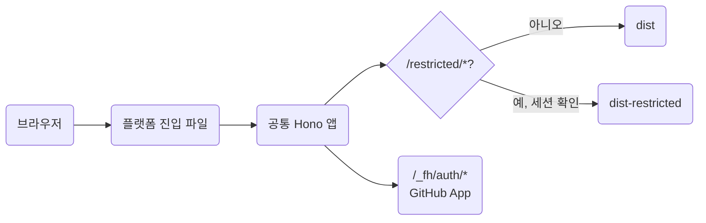

# 서버 기능 설계

상태: 설계 초안(2026-11-02), 구현 전 검토 반영(2026-11-03). Roadmap의 [Search](roadmap.md#search), [Server features](roadmap.md#server-features)와 Architecture의 [Search, identity and storage](architecture.md#search-identity-and-storage)를 구조와 단계로 옮긴다. 구현 순서는 단계마다 별도 계획 문서에 둔다.

## 목적

정적 문서 사이트를 그대로 두고, 필요한 프로젝트만 검색, 로그인, 제한 문서, 화면 편집을 켤 수 있게 한다. 공개 문서만 쓰는 사용자는 지금처럼 서버 없이 `dist`를 배포한다.

## 결정

1. 문서의 원본은 Git 저장소의 Markdown 하나다. DB는 문서 원본으로 쓰지 않는다. 문서 목록은 `loadSite`가 메모리에 만드는 store, 검색은 빌드 때 만드는 인덱스로 충분하다.
2. 정적 출력이 기본 제품이다. 서버는 선택이며, 제한 폴더와 서버 진입점을 쓰지 않는 프로젝트의 출력은 2단계와 3단계로 바뀌지 않는다.
3. Hono 앱은 플랫폼 중립이다. 플랫폼 전용 코드는 진입 파일에만 둔다.
4. 신원과 권한은 GitHub에 맡긴다. 문서 저장소의 읽기 권한이 제한 문서 읽기, 쓰기 권한이 편집 권한이다. 사용자 테이블과 권한 테이블을 만들지 않는다.
5. 제한 문서는 비공개 저장소에서만 제공한다. 공개 저장소에서는 `content/restricted`의 원본을 누구나 GitHub에서 읽을 수 있어 로그인 가드가 의미가 없다. 서버는 저장소가 공개로 확인되면 제한 문서를 내주지 않는다.
6. 서버에 세션 저장소가 없다. 권한은 로그인할 때 확인하고, 세션이 끝나면 다시 로그인하면서 갱신한다. 권한 회수는 세션 수명 안에 반영된다.
7. 편집의 저장은 커밋이다. 버전, 초안, 검토, 충돌 검사는 Git과 GitHub가 맡는다.
8. 비밀값은 서버 환경 변수에서만 읽는다. HTML, 브라우저 번들, 설정 출력에 넣지 않는다.

### 참고한 구조

TinaCMS는 정적 admin SPA, 토큰과 로그인과 색인 DB를 가진 백엔드, GitHub API 커밋으로 이루어진다. 색인 DB는 원본이 아니라 다시 만들 수 있는 캐시다. 이 설계는 커밋 모델을 가져오고 색인 DB와 React 라이브 미리보기는 뺀다. 라이브 미리보기는 페이지가 React로 그려질 때만 가능하고 for-humanity는 서버 HTML이다.

### 적용 범위

제한 문서의 독자는 문서 저장소의 협업자다. 개발 팀의 내부 문서에 맞고, GitHub 계정이 없는 독자가 많은 문서에는 맞지 않는다. GitHub Team 이상의 조직에서는 비공개 저장소의 외부 협업자가 읽기 권한만 가져도 유료 좌석을 쓴다. 그런 요구가 생기면 신원 제공자를 OIDC와 명시 허용 목록으로 넓힌다.

## 기능별 필요 자원

| 기능 | 운영 서버 | DB | 데이터 위치 | 단계 |
| --- | --- | --- | --- | --- |
| 검색 | 없음 | 없음 | 빌드 때 만든 정적 인덱스 | 1 |
| 편집 링크 | 없음 | 없음 | GitHub 웹 편집기 | 1 |
| 로그인과 제한 문서 | Node 또는 Workers | 없음 | GitHub 권한과 서명 쿠키 | 2 |
| 화면 편집 | Node | 없음 | Git 저장소 | 3 |
| 댓글, 조회수, 읽음 표시 | 필요 | 필요 | 문서 경로를 키로 쓰는 부가 저장소 | 미계획 |

## 1단계: 검색과 편집 링크

서버 없이 정적 출력에 추가한다. 배포 방식은 바뀌지 않는다. 두 기능은 서로 독립이라 따로 공개할 수 있다.

### 검색

엔진은 Pagefind다. 실제 문서 모음 두 개에서 MiniSearch와 비교해 정했다([검색 엔진 비교](#검색-엔진-비교)).

- 인덱스 입력은 공개 HTML 파일이 아니라 store의 문서 본문으로 만든 색인용 HTML이다. 문서마다 `<html lang>`, 제목, 본문만 담아 Pagefind Node API의 `addHTMLFile`에 넘긴다. 사이드바, 404, 사이트 이름이 결과에 섞이지 않고 dev와 build가 같은 경로로 인덱스를 만든다.
- 색인용 HTML은 표 칸 사이와 Details 제목 뒤에 공백을 넣는다. Pagefind는 이웃한 `<th>`와 `summary` 뒤 본문을 공백 없이 붙여 색인한다.
- 출력 위치는 `basePath` 아래의 `/_fh/search/<지문>/`이다. Pagefind의 `pagefind.js`, 진입 JSON, wasm은 이름에 지문이 없어 폴더 전체에 지문을 붙인다. 그래서 `/_fh/*`의 장기 캐시 규칙을 그대로 쓴다. 같은 입력이면 출력이 바이트 단위로 같아서(51문서, 파일 75개로 확인) 문서가 바뀌지 않은 배포는 지문도 그대로다.
- 언어별 인덱스는 Pagefind가 `<html lang>`으로 나눈다. 영어에는 어간 처리가 붙고 한국어에는 없다.
- dev는 store가 바뀔 때 Node API로 인덱스를 다시 만든다. 측정한 두 문서 모음의 전체 재생성은 0.16초와 0.47초였다. dev 인덱스에는 dev가 보이는 내부 문서와 제한 문서도 들어간다.
- 검색 상자와 단축키는 `browser.js`의 작은 위젯이다. Pagefind 모듈은 첫 입력 때 동적으로 불러온다. 모든 HTML에 인라인으로 들어가는 번들에 엔진을 넣지 않는다.
- 질의의 각 어절에서 끝의 조사 하나를 떼고 찾는다. 떼고 남은 말이 두 음절 이상일 때만 뗀다. 접두 일치라 지나치게 떼어도 원래 말을 찾는다. 이 처리기는 gzip 0.9KB다.
- 결과는 문서와 section이다. section은 `sub_results`에서 일치 수가 가장 많은 것을 고른다. 첫 항목을 고르면 맞는 section이 23/36, 일치 수로 고르면 32/36이었다. Pagefind가 한글 id를 퍼센트 인코딩하므로 hash는 `decodeURIComponent` 뒤에 비교한다.
- Pagefind는 플랫폼별 바이너리(12~13.5MB)를 optionalDependencies로 받는다. Vite 8의 Rolldown도 같은 방식이라 새 설치 조건은 아니다. 바이너리가 없으면 `build`가 원인과 해결 방법을 알리며 실패하고, dev는 경고만 낸 뒤 검색 없이 뜬다. `search: false`면 바이너리 없이 빌드된다.
- 버전은 Shiki와 Mermaid처럼 정확히 고정한다. Pagefind가 만드는 JS와 wasm은 사이트와 함께 배포되므로 Mermaid처럼 라이선스 고지를 같이 낸다.
- 검색은 기본 켬이며 `search: false`로 끈다.
- 설치 검사에 인덱스 생성, dev 갱신, 결과의 hash 이동을 넣는다.

### 검색 엔진 비교

2026-11-03에 공식 사이트(영어 14, 한국어 14 문서)와 설치 사용자 사이트 하나(한국어 51 문서)의 빌드 결과로 측정했다. 질의마다 기대한 문서를 원문에서 확인하고, 그 문서가 상위 3개 안에 든 수를 셌다.

| 항목 | Pagefind | Pagefind, 질의 조사 처리 | MiniSearch, 조사와 식별자 처리 |
| --- | --- | --- | --- |
| 한국어 질의 48개 | 36 | 40 | 35, fuzzy를 켜면 38 |
| 본문과 다른 조사로 쓴 질의 7개 | 3 | 7 | 7 |
| 띄어쓰기가 본문과 다른 질의 9개 | 5 | 5 | 1 |
| 영어 질의 8개 | 8 | 8 | 6 |
| 첫 검색 전 전송량, 28문서 | 135KB | 135KB | 59KB |
| 첫 검색 전 전송량, 51문서 | 145KB | 145KB | 266KB, 발췌문을 보이려면 256KB 더 |

- MiniSearch는 인덱스 전체를 먼저 받아야 해서 문서가 늘수록 불리하다. Pagefind는 인덱스를 조각으로 나눠 필요한 만큼만 받는다.
- MiniSearch의 장점은 바이너리가 없고 dev에서 문서 하나만 다시 색인하는 것이었다. Node API의 전체 재생성이 측정한 두 문서 모음에서 1초 안에 끝나 결정을 바꾸지 않았다.
- 붙여 쓴 복합어 안의 단어(생명주기 안의 주기)는 세 방식 모두 찾지 못했다.

### 편집 링크

- `repository` 설정이 있으면 문서 아래에 GitHub 웹 편집기 링크를 둔다. 대상은 `https://github.com/<name>/edit/<branch>/<파일 경로>`이고, 파일 경로는 `dir`, `content.root`, 문서 파일 경로를 이은 저장소 안 경로다.
- `repository`는 `"owner/name"` 또는 `{name, branch, dir, edit}`이다. `branch` 기본값은 `main`, `dir`은 저장소 루트에서 프로젝트 루트까지의 경로로 기본값은 빈 값이다. 모노레포나 하위 폴더 프로젝트가 `dir`을 적는다. 2단계와 3단계가 같은 값을 쓴다.
- 비공개 저장소의 공개 문서에서는 링크가 방문자에게 GitHub 404가 된다. 그런 프로젝트는 `repository.edit: false`로 링크를 모두 끄고 `repository`는 로그인과 편집에만 쓴다.
- 문서 하나는 frontmatter `edit: false`로 링크를 뺀다. 다른 파일에서 동기화해 만드는 문서가 대상이며, 공식 사이트의 changelog가 그 예다.
- store의 문서마다 원본 파일 경로를 둔다. 지금은 경고 출력에만 쓰고 문서 결과에는 없다.
- 쓰기 권한이 없는 사용자에게는 GitHub가 fork와 변경 제안을 연다. 비공개 저장소의 fork는 조직이 허용할 때만 되고, 새 조직의 기본값은 금지다.

## 2단계: 제한 문서와 서버 모드

로그인한 사용자에게만 보이는 문서가 필요한 프로젝트가 켠다.

### 문서 범위

지금의 두 범위에 하나를 더한다.

| 범위 | 폴더 | URL | dev | build | 운영 |
| --- | --- | --- | --- | --- | --- |
| 공개 | `content/public` | `/<path>/` | 포함 | `dist` | 정적 호스팅 또는 서버 |
| 제한 | `content/restricted` | `/restricted/<path>/` | 포함 | `dist-restricted` | 서버가 권한 확인 뒤 제공 |
| 내부 | `content/private` | `/private/<path>/` | 포함 | 제외 | 없음 |

제한 문서를 폴더로 두는 이유는 내부 문서와 같다. 공개 문서와 홈이 제한 자료를 참조하면 `assertContentPath`가 지금처럼 오류를 내고, 제한 문서가 쓰는 그림과 스니펫은 `dist-restricted` 쪽에만 모인다. frontmatter 표지로 하면 공개 자원 폴더에 제한 그림이 섞이는 경로를 하나하나 막아야 한다. URL 접두 `/restricted/`는 서버 가드가 경로 하나로 끝나게 한다. 별도 목록 파일이 없다.

- 참조 방향은 공개, 제한, 내부 순으로 넓어진다. 공개 문서와 홈은 공개 자료만, 제한 문서는 공개와 제한 자료를 참조한다. 어긋나면 지금의 내부 참조처럼 원본 위치가 있는 오류로 멈춘다. 제한 문서가 내부 자료를 참조해도 오류다. 내부 자료가 로그인 사용자에게 배포되기 때문이다.
- 문서 id의 첫 조각 `restricted`는 제한 폴더가 있는 프로젝트에서만 예약한다. `url`을 설정한 사이트만 크롤러 파일 이름을 예약하는 것과 같다. 기존 프로젝트는 그대로 빌드된다.
- 제한 폴더는 번역 폴더에 미러링하지 않는다. 내부 문서와 같다.
- `content/restricted/README.md`가 있으면 `/restricted/` 홈이다.
- 공개 페이지의 탐색, 사이트맵, 검색 인덱스에는 제한 문서가 없다. 제한 페이지의 탐색은 공개 문서와 제한 문서를 함께 보인다. 공개 페이지에는 제한 영역 입구 링크 하나만 두고 제한 문서의 제목은 넣지 않는다.
- 이름은 `private`과 `restricted`를 그대로 쓴다. `private`을 바꾸면 기존 프로젝트의 설정과 dev URL이 모두 바뀐다. 배포 제외와 로그인 뒤 제공의 차이는 Content layout과 Settings의 표 하나로 설명한다.

`dist`에는 어떤 플랫폼에서도 제한 문서가 들어가지 않는다. 사이트 전체를 비공개로 하려는 프로젝트는 이 기능 대신 호스팅의 접근 제어를 안내한다.

### 출력

- 제한 폴더가 있으면 `build`가 `dist` 옆에 `dist-restricted`를 만든다. 두 폴더 모두 빌드 시작 때 지우므로 제한 폴더를 없애면 `dist-restricted`도 남지 않는다.
- `dist-restricted`의 파일 경로는 URL과 같다. `/restricted/guide/`는 `dist-restricted/restricted/guide/index.html`이다. Node의 파일 응답과 Workers에 묶는 모듈이 같은 경로를 키로 쓴다.
- 제한 영역의 404, 403, 설정 오류 화면은 지금의 404처럼 build가 상태 화면으로 만들어 `dist-restricted`에 둔다. 서버는 화면을 그리지 않고 파일을 고른다.
- CSS, 글꼴, Mermaid 같은 패키지 자원은 공개 `/_fh/`를 함께 쓴다. 제한 문서가 수집한 그림과 첨부는 `/restricted/_fh/media/` 아래에 두어 같은 가드를 지나게 한다. 공개 문서도 같은 파일을 쓰면 양쪽에 따로 들어간다.
- `dist-restricted`는 예약 폴더 목록, dev 감시 제외, `init`이 만드는 `.gitignore`에 넣는다.
- GitHub Pages와 Workers 자산 설정은 지금처럼 `dist`만 올린다. `build`는 제한 문서 수와 함께 서버 없이는 제공되지 않는다고 알린다.

### 신원과 권한

GitHub App 하나를 사용자가 자기 계정이나 조직에 만들고 문서 저장소에 설치한다. App 권한은 Metadata 읽기이고 3단계에서 Contents 쓰기를 더한다. 로그인은 그 App의 사용자 인증 흐름이며 `state`와 PKCE(S256)를 쓴다. `state`, PKCE verifier, 돌아갈 경로는 10분짜리 서명 쿠키에 둔다. 이 쿠키는 `SameSite=Lax`여야 GitHub에서 돌아오는 최상위 이동에 실린다.

콜백에서 서버는 사용자 토큰으로 `GET /user`와 `GET /repos/<name>`을 한 번씩 호출한다. 앞에서 GitHub 사용자 id와 로그인 이름을, 뒤에서 `permissions`의 `pull`과 `push`, `private`를 얻는다. 사용자 토큰의 권한은 사용자와 App이 함께 가진 권한뿐이다. 접근할 수 없는 비공개 저장소는 404로 오므로 읽기 권한 없음으로 처리한다. `private`가 거짓이면 결정 5에 따라 설정 오류 화면을 보인다. GitHub 호출이 실패하거나 한도에 걸리면 세션을 만들지 않고 다시 시도하라는 화면을 보인다.

세션은 비밀키로 서명한 쿠키 하나다. 내용은 형식 버전, GitHub 사용자 id, 로그인 이름, 권한 수준, 발급과 만료 시각이다. 2단계 쿠키에는 GitHub 토큰을 넣지 않는다. 토큰은 콜백 처리 안에서만 쓰고 버린다.

세션 수명 기본값은 8시간이다. GitHub App 사용자 토큰도 8시간 뒤 만료된다. 만료된 세션의 `/restricted/*` 요청은 로그인을 다시 거치고, 이미 GitHub에 로그인해 App을 승인한 사용자는 화면 없이 돌아온다. refresh 토큰은 쓰지 않는다. 한 번 쓰면 무효가 되는 토큰이라 세션 저장소 없이 여러 인스턴스가 나눠 갱신할 수 없다.

권한을 회수한 사용자는 세션이 끝날 때까지 제한 문서를 읽는다. 로그아웃은 그 브라우저의 쿠키만 지운다. 모든 세션을 바로 끝내려면 `FH_SESSION_SECRET`를 바꾼다.

OAuth App 대신 GitHub App을 고른 이유는 토큰 범위다. OAuth App의 비공개 저장소 접근은 `repo` 범위라서 사용자가 닿는 모든 저장소에 미친다. GitHub App의 사용자 토큰은 설치한 저장소에만 미친다.

환경 변수는 `FH_GITHUB_CLIENT_ID`, `FH_GITHUB_CLIENT_SECRET`, `FH_SESSION_SECRET` 셋이다. `FH_SESSION_SECRET`는 32바이트 이상의 무작위 값이다. 설정에는 `repository`와 `url`이 필요하다.

콜백 주소는 요청의 Host 헤더로 만들지 않는다. 설정 `url`과 로컬 `http://localhost:<port>`만 허용하고, 그 밖의 주소에서 온 로그인 요청은 거부한다. GitHub App에는 이 콜백 주소들을 등록한다(최대 10개). Workers 미리보기 주소는 버전과 브랜치마다 달라 미리 등록할 수 없으므로 미리보기 배포에서는 로그인하지 않는다.

조직이 SAML SSO를 강제하면 사용자는 로그인할 때 SSO 세션이 있어야 한다. GitHub 바깥의 신원 제공자는 [적용 범위](#적용-범위)의 요구가 생길 때 넓힌다.

### GitHub App 만들기

사용자가 App을 직접 만드는 마찰은 GitHub App manifest 흐름으로 줄인다. 별도 명령이 이름, 홈페이지, 콜백 주소, 권한, 비공개 App 여부를 담은 manifest를 브라우저로 GitHub에 보낸다. 돌아온 `code`를 한 시간 안에 `POST /app-manifests/{code}/conversions`로 바꾸면 client id와 secret을 받는다. 결과는 `.env`나 `.dev.vars`에 쓰고 운영 비밀값을 등록하는 명령을 출력한 뒤, 문서 저장소에 App을 설치하는 링크를 연다.

함께 오는 private key(`pem`)와 webhook secret은 쓰지 않으므로 저장하지 않는다. webhook도 쓰지 않는다. 사용자 토큰 만료는 manifest로 정할 수 없고 새 App의 기본값인 만료 켬을 따른다. 이 흐름이 실패하는 환경을 위해 설정 화면에서 직접 만드는 절차도 문서로 남긴다.

### 라우트

`/_fh/`는 이미 자원 폴더로 예약되어 있어 서버 라우트도 그 아래에 둔다. 표의 경로는 모두 `basePath` 아래이고, 끝 슬래시가 없는 `/restricted`는 `/restricted/`로 보낸다.

| 경로 | 응답 |
| --- | --- |
| `GET /_fh/auth/login` | 돌아갈 경로 확인, 상태 쿠키 발급, GitHub 로그인으로 이동 |
| `GET /_fh/auth/callback` | 상태 확인, 토큰 교환, 권한과 저장소 공개 여부 확인, 세션 쿠키 발급, 돌아갈 경로로 이동 |
| `POST /_fh/auth/logout` | 세션 쿠키 삭제 |
| `/restricted/*` | 세션이 없거나 끝났으면 경로의 존재와 무관하게 로그인으로, 읽기 권한이 없으면 403 화면, 있으면 `dist-restricted`의 파일, 없는 파일은 404 |
| 그 밖 | `dist`의 정적 파일, 없으면 404 |

### 보안 규칙

- 세션 쿠키는 Hono의 서명 쿠키이고 `__Host-` 접두, `HttpOnly`, `Secure`, `SameSite=Lax`, `Path=/`다.
- 로그아웃과 3단계의 저장, 미리보기는 Hono `csrf()`로 `Origin`과 `Sec-Fetch-Site`를 검사한다. 로그아웃을 GET으로 두지 않는 이유다.
- 돌아갈 경로는 사이트의 `/restricted/` 아래 상대 경로만 받는다. `//`, 스킴, 역슬래시가 있으면 `/restricted/`로 바꾼다.
- `/restricted/` 아래 HTML, 로그인 이동, 403 응답은 `Cache-Control: private, no-store`다. 내용 지문이 붙은 제한 자원은 `private, max-age=31536000, immutable`이다. 모두 `X-Robots-Tag: noindex`를 붙인다. 공개 `/_fh/*`의 `public, immutable` 규칙은 경로가 달라 제한 자원에 걸리지 않는다.
- 쿠키, 토큰, 콜백의 `code`를 로그에 남기지 않는다.
- 공개 문서와 제한 문서는 같은 출처다. 문서의 원시 HTML과 인터랙티브 그림의 스크립트는 로그인한 사용자의 쿠키로 제한 문서를 읽을 수 있다. 저장소에 쓸 수 있는 사람은 신뢰 대상이다. 공개 페이지에 외부 스크립트를 넣으면 그 스크립트에도 제한 문서가 열린다고 안내한다.
- GitHub 웹과 API 주소를 주입할 수 있게 만든다. 테스트는 가짜 GitHub 서버로 로그인, 권한, 공개 여부, 저장을 확인한다. GitHub Enterprise Server 지원도 같은 자리에서 연다.

### 패키지와 플랫폼

패키지는 `for-humanity/server`에서 Hono 앱을 만드는 함수 하나를 내보낸다. 입력은 사이트 설정, 공개 출력과 제한 출력을 읽는 방법, 환경 변수다. 정적 전용 사용자는 이 진입점을 가져오지 않는다.

| 플랫폼 | 진입 | 공개 출력 | 제한 출력 | 순서 |
| --- | --- | --- | --- | --- |
| Node.js 서버와 컨테이너 | `for-humanity serve` | 파일 시스템 | 파일 시스템 | 첫 구현, 테스트 기준 |
| Cloudflare Workers | `init`이 만드는 `worker.ts` | Static Assets, Worker를 거치지 않음 | Worker 스크립트에 묶은 모듈 | 2단계 완료 조건 |
| AWS Lambda 등 | `hono/aws-lambda` 어댑터를 사용자가 작성 | S3 등 | 미정 | 요청 시 |

Node를 먼저 구현하는 이유는 `loadSite`와 파일 응답이 이미 Node 파일 시스템 위에 있어 가드와 로그인 라우트만 더하면 되기 때문이다. Node가 되면 컨테이너와 VM 계열 호스팅이 모두 된다. 다만 공식 사이트와 지금의 설치 사용자 사이트는 Workers나 GitHub Pages에 있으므로, Workers가 동작하기 전에는 2단계를 끝난 것으로 보지 않는다.

`serve`는 `dist`를 Workers 설정과 같은 규칙으로 응답한다. 끝 슬래시 정규화, `404.html`, HTML 재검증, `/_fh/*` 장기 캐시, 응답 압축이다. 이를 위해 `@hono/node-server`를 다시 직접 의존성으로 둔다. 빌드 결과가 없으면 `preview`처럼 시작 전에 실패한다. 운영 서버라서 수신 포트와 주소는 `PORT`, `HOST` 환경 변수를 먼저 보고, 없으면 `port`, `host` 설정을 쓴다. 컨테이너에서는 `HOST=0.0.0.0`이 필요하다고 안내한다. 비밀값은 환경 변수로만 받고, 로컬 확인에서는 `node --env-file`처럼 프로세스 바깥에서 넣는다.

Workers에서는 공개 경로가 Worker를 거치지 않는다. `assets.run_worker_first`에 `/restricted`, `/restricted/*`, `/_fh/auth/*`만 적는다. `/restricted/*`는 `/restricted`와 맞지 않아 둘 다 적는다. `not_found_handling`을 쓰면 목록에 없는 경로는 Worker에 오지 않으므로 서버 라우트를 빠짐없이 적는다. 무료 요금제에서는 이 경로들의 요청만 Worker 한도에 들어간다.

제한 출력은 `build`가 만든 모듈로 Worker 스크립트에 묶는다. 공개 자산에 섞이지 않고, 코드와 같은 버전으로 배포되며, 미리보기 배포도 자기 버전의 제한 문서를 쓴다. Worker 크기 한도는 압축 전 64 MiB이고 압축 크기 한도는 없다. 그림이 많아 한도에 다가가는 프로젝트는 그때 KV로 옮기는 방법을 설계한다. 다른 두 방법을 고르지 않은 이유는 다음과 같다.

- 같은 자산 묶음의 `/restricted/` 아래에 두고 `run_worker_first`로 막는 방법은 설정이 가장 짧다. 그러나 대소문자와 인코딩된 경로를 어떻게 맞추는지 문서에 없어 보안 경계를 거기에 두지 않는다.
- 제한 자산만 가진 두 번째 Worker를 서비스 바인딩으로 읽는 방법은 Workers Builds에서 Worker마다 저장소를 따로 연결해야 한다. 빌드가 두 번 돌고, 두 배포 사이에 제한 HTML과 공개 CSS의 지문이 어긋날 수 있다.

dev는 지금처럼 Vite 서버 하나다. 제한 문서는 내부 문서처럼 로그인 없이 보인다. dev에는 로그인 라우트를 붙이지 않고, 실제 GitHub 왕복과 가드는 `build` 뒤 로컬 `serve`에서 확인한다. 가드 없는 화면에 로그인만 붙은 중간 상태를 두지 않기 위해서다. `preview`는 지금처럼 `dist`만 보이고 제한 문서는 보이지 않는다.

### 검색과 제한 문서

첫 구현에서 제한 문서는 검색 대상이 아니다. 필요해지면 제한 문서만으로 두 번째 인덱스를 만들어 `/restricted/_fh/search/<지문>/`에 두고 같은 가드 뒤에서 제공한다. 따로 만든 인덱스라 공개 인덱스와 섞이지 않는다.

### 구현 순서

1. 제한 범위 빌드: 범위와 참조 규칙, `dist-restricted` 출력과 자원 경로, 예약 이름, 공개 출력 제외 검사. 서버 없이 끝나며 누출 검사를 먼저 고정한다.
2. 서버와 로그인: 공통 Hono 앱, GitHub 로그인, 가드와 캐시 규칙, `serve`, 가짜 GitHub 테스트.
3. Workers와 설치 흐름: Workers 진입점과 제한 출력 제공, `init`의 서버 설정, GitHub App 만들기 명령.

## 3단계: 화면 편집

2단계 위에 얹는다. 아래 기본 편집 흐름으로 부족하다는 요구가 실제로 있을 때 시작한다.

기본 편집 흐름은 1단계 편집 링크와 브랜치 미리보기 배포다. GitHub 웹 편집기에서 새 브랜치로 변경을 제안하면 Workers Builds가 그 브랜치를 미리보기 주소에 배포한다. 렌더 결과가 실제 빌드와 같고 서버 코드가 필요 없다. 3단계가 더하는 것은 빌드를 기다리지 않는 미리보기다. 이 흐름은 Deployment 안내에 적는다. GitHub Pages에는 브랜치 미리보기 배포가 없어 편집 링크만 쓴다.

- 3단계는 Node에서만 제공한다. 미리보기에는 Shiki를 포함한 processor와, 그림, 스니펫, 링크를 확인할 원본 트리가 필요하다. Workers에는 원본 트리와 파일 시스템이 없고, processor의 그림과 스니펫 처리가 Node 파일 API를 쓴다.
- 편집 화면은 `/_fh/edit/<문서 경로>`다. 왼쪽은 Markdown 소스 편집기, 오른쪽은 미리보기다. 편집기는 textarea로 시작하고 부족하면 CodeMirror를 쓴다. WYSIWYG은 하지 않는다. `:::note`, `::part`, fx 그림 같은 문법을 왕복하면서 보존하려면 편집기를 새로 만드는 일이 된다. 블록 삽입 버튼은 소스 편집기 위에 얹을 수 있다.
- 미리보기는 `POST /_fh/api/preview`에 Markdown을 보내면 서버의 기존 processor가 HTML 조각을 돌려준다. 입력이 멈출 때 요청한다. 링크, 그림, 스니펫은 `serve`가 실행 중인 원본 트리 기준으로 푼다. 원본 트리에 없는 그림과 문서 링크는 빌드 경고와 같은 문구로 미리보기 안에 보인다.
- 읽기는 `GET /_fh/api/file`, 저장은 `PUT /_fh/api/file`이다. 둘 다 쓰기 권한 세션이 필요하고 경로는 문서 루트 안의 Markdown으로 제한한다. 저장은 세션의 사용자 토큰으로 GitHub Contents API를 호출해 설정한 브랜치에 커밋한다. 커밋 작성자는 그 사용자다. 읽을 때 받은 sha를 저장에 보내고 GitHub가 sha 불일치로 거부하면 다시 불러오기를 안내한다. 그것이 동시 편집 검사다.
- 3단계 세션에는 GitHub 사용자 토큰이 들어간다. 이 쿠키는 Web Crypto의 AES-GCM으로 암호화하고 수명을 토큰 만료에 맞춘다. 토큰 교환 때 `repository_id`로 토큰을 문서 저장소 하나에 묶을 수 있는지 구현 때 확인한다.
- 저장 중에 세션이 끝나면 저장 요청은 401을 받는다. 편집 화면은 입력을 브라우저에 보관하고 로그인을 거쳐 돌아온 뒤 복원한다.
- 브랜치 규칙으로 직접 커밋이 거부되면 GitHub 웹 편집기 링크로 안내한다. 새 브랜치에 커밋하고 PR을 여는 저장 방식이 다음 후보이고, 브랜치 미리보기 배포와 이어진다.
- 미리보기와 저장의 본문은 1MB로 제한한다. Contents API가 전체 JSON으로 다루는 크기와 같다.
- 저장이 사이트에 반영되는 시점은 기존 배포 흐름이 정한다. Workers Builds나 CI가 커밋을 받아 다시 빌드하므로 분 단위 지연이 있다. 즉시 반영은 목표가 아니다.
- dev에서는 같은 화면이 GitHub 대신 로컬 파일에 쓰고 Vite가 갱신한다. 파일 읽기와 쓰기 구현이 로컬과 GitHub 둘이다.
- 그림 업로드, 새 문서 만들기, 브랜치 선택은 첫 구현에 넣지 않는다. 편집 경로가 문서 루트 안이라 `.github/workflows`를 고칠 일이 없고 Workflows 권한도 필요 없다.

## 미계획: 런타임 상태

댓글, 반응, 조회수, 읽음 표시처럼 문서가 아닌 상태가 요청되면 그때 설계한다. 문서 경로를 키로 쓰는 부가 저장소이며 Node는 SQLite, Workers는 D1이 후보다. 문서 본문은 거기 들어가지 않는다. 실시간 공동 편집과 블록 댓글은 DB 원본과 CRDT가 필요한 다른 제품이라 범위 밖이다.

## 설정과 환경 변수 요약

| 항목 | 단계 | 뜻 |
| --- | --- | --- |
| `search` | 1 | 검색 인덱스와 상자, 기본 `true` |
| `repository` | 1, 2, 3 | `"owner/name"` 또는 `{name, branch, dir, edit}`. 편집 링크, 권한 확인, 커밋 대상. `branch` 기본 `main`, `edit` 기본 `true` |
| frontmatter `edit` | 1 | `false`면 그 문서의 편집 링크를 뺌 |
| `content.restricted` | 2 | 제한 폴더 이름, 기본 `restricted` |
| `url` | 2 | 로그인 콜백 주소의 기준 |
| `PORT`, `HOST` | 2 | `serve`의 수신 포트와 주소. 없으면 `port`, `host` 설정 |
| `FH_GITHUB_CLIENT_ID`, `FH_GITHUB_CLIENT_SECRET` | 2 | GitHub App의 사용자 인증 |
| `FH_SESSION_SECRET` | 2 | 세션 쿠키 서명. 3단계의 암호화 키도 여기서 만든다 |

`server` 같은 별도 설정 키는 두지 않는다. 서버 모드는 `serve` 명령이나 서버 진입점을 쓰는 것으로 켜진다.

## 완료 기준

- 제한 폴더와 서버 진입점을 쓰지 않는 프로젝트의 `build` 출력이 2단계와 3단계 변경 전후로 바이트 단위로 같다.
- 제한 폴더가 있는 프로젝트의 `dist`에 제한 문서의 HTML, 그림, 첨부, 탐색 항목, 사이트맵 항목, 검색 인덱스 항목이 없다. 설치 검사의 sentinel 방식으로 확인한다.
- 로그인 없는 `/restricted/*` 요청은 경로가 있든 없든 로그인으로 이동하고, 읽기 권한이 없는 사용자는 403, 있는 사용자는 문서를 받는다. 공개 저장소를 가리키는 서버는 제한 문서를 주지 않는다.
- 제한 응답에 `private` 캐시 규칙과 `noindex`가 있고, 2단계 세션 쿠키에 GitHub 토큰이 없다.
- HTML, 브라우저 번들, 설정 출력에 비밀값과 사용자 토큰이 없다.
- 위 서버 검사가 Node `serve`와 Workers에서 같은 결과를 낸다.
- 검색은 실제 문서 모음에서 원하는 section으로 이동하고 결과와 hash가 일치한다.
- 편집은 저장 뒤 GitHub에 그 사용자의 커밋이 생기고, 오래된 sha의 저장은 거부된다.

## 미결

### 정할 것

- 공개 페이지에 둘 제한 영역 입구의 모양과 문구.
- 세션 수명을 설정으로 열지. 기본 8시간.
- 3단계의 PR 저장 방식을 첫 구현에 넣을지.
- 붙여 쓴 복합어 안의 단어 검색. 요구가 생기면 색인용 HTML에 음절 단위 보조어를 넣는 방법을 측정한다.
- 오타 허용. Pagefind에는 fuzzy 검색이 없다.

### 구현 첫 단계에서 확인할 것

문서에 명시가 없어 실제 GitHub와 브라우저로 확인한다.

- manifest 흐름의 `redirect_url`에 `localhost`를 쓸 수 있는지.
- GitHub App 사용자 토큰으로 받은 `GET /repos/<name>`의 `permissions`가 사용자의 저장소 역할을 그대로 보이는지. 다르면 `GET /repos/<name>/collaborators/<login>/permission`을 쓴다.
- 로컬 `http://localhost`의 `serve`에서 주요 브라우저가 `__Host-` 접두의 `Secure` 쿠키를 저장하는지. 안 되면 로컬에서만 접두 없는 이름을 쓴다.
