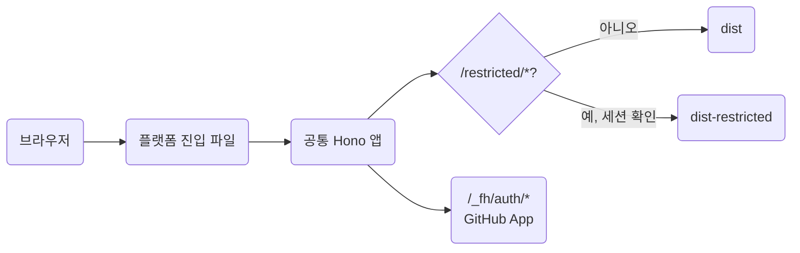

# 서버 기능 설계

상태: 설계 초안(2026-11-02). Roadmap의 [Server features](roadmap.md#server-features)와 Architecture의 [Search, identity and storage](architecture.md#search-identity-and-storage)에 적은 원칙을 구조와 단계로 옮긴다. 구현 순서는 승인 뒤 별도 계획 문서에 둔다.

## 목적

정적 문서 사이트를 그대로 두고, 필요한 프로젝트만 검색, 로그인, 제한 문서, 화면 편집을 켤 수 있게 한다. 공개 문서만 쓰는 사용자는 지금처럼 서버 없이 `dist`를 배포한다.

## 결정

1. 문서의 원본은 Git 저장소의 Markdown 하나다. DB는 문서 원본으로 쓰지 않는다. 문서 목록은 `loadSite`가 메모리에 만드는 store, 검색은 빌드 때 만드는 인덱스로 충분하다.
2. 정적 출력이 기본 제품이다. 서버는 선택이며, 끄면 지금과 같은 출력이 나온다.
3. Hono 앱은 플랫폼 중립이다. 플랫폼 전용 코드는 진입 파일에만 둔다.
4. 신원과 권한은 GitHub에 맡긴다. 문서 저장소의 읽기 권한이 제한 문서 읽기, 쓰기 권한이 편집 권한이다. 사용자 테이블과 권한 테이블을 만들지 않는다.
5. 편집의 저장은 커밋이다. 버전, 초안, 검토, 충돌 검사는 Git과 GitHub가 맡는다.
6. 비밀값은 서버 환경 변수에서만 읽는다. HTML, 브라우저 번들, 설정 출력에 넣지 않는다.

### 참고한 구조

TinaCMS는 정적 admin SPA, 토큰과 로그인과 색인 DB를 가진 백엔드, GitHub API 커밋으로 이루어진다. 색인 DB는 원본이 아니라 다시 만들 수 있는 캐시다. 이 설계는 커밋 모델을 가져오고 색인 DB와 React 라이브 미리보기는 뺀다. 라이브 미리보기는 페이지가 React로 그려질 때만 가능하고 for-humanity는 서버 HTML이다.

## 기능별 필요 자원

| 기능 | 운영 서버 | DB | 데이터 위치 | 단계 |
| --- | --- | --- | --- | --- |
| 검색 | 없음 | 없음 | 빌드 때 만든 정적 인덱스 | 1 |
| 편집 링크 | 없음 | 없음 | GitHub 웹 편집기 | 1 |
| 로그인과 제한 문서 | 필요 | 없음 | GitHub 권한과 서명 쿠키 | 2 |
| 화면 편집 | 필요 | 없음 | Git 저장소 | 3 |
| 댓글, 조회수, 읽음 표시 | 필요 | 필요 | 문서 경로를 키로 쓰는 부가 저장소 | 미계획 |

## 1단계: 검색과 편집 링크

서버 없이 정적 출력에 추가한다. 배포 방식은 바뀌지 않는다.

- 검색 인덱스는 `build`의 마지막에 `dist`를 입력으로 만들고 `/_fh/pagefind/` 아래에 둔다. 후보는 Roadmap의 Pagefind다. npm 패키지가 linux, darwin, windows의 x64와 arm64 바이너리를 optionalDependencies로 나눠 두어 설치 환경에 맞는 하나만 받는다. 설치 검사에 인덱스 생성을 포함한다.
- 브라우저 검색 상자는 기존 `browser.js` 번들의 위젯이다. 인덱스는 첫 검색 때 받는다. 결과는 문서와 section 단위이고 이동 뒤 hash가 결과와 일치한다.
- 한국어는 조사가 붙은 어절을 같은 말로 보지 못하는 문제가 있다. 실제 문서 모음에서 Pagefind와 MiniSearch의 접두 일치를 비교해 고른다. MiniSearch는 빌드 때 JSON 하나를 만들고 바이너리가 없다.
- 검색은 기본 켬이며 `search: false`로 끈다.
- 편집 링크는 `repository` 설정이 있을 때 문서 아래에 GitHub 웹 편집기 링크를 둔다. 대상은 `https://github.com/<repository>/edit/<branch>/<문서 파일 경로>`다. 저장소 설정은 2단계와 3단계가 같은 값을 쓴다.

## 2단계: 서버 모드

로그인한 사용자에게만 보이는 문서가 필요한 프로젝트가 켠다.

### 문서 범위

지금의 두 범위에 하나를 더한다.

| 범위 | 폴더 | URL | dev | build | 운영 |
| --- | --- | --- | --- | --- | --- |
| 공개 | `content/public` | `/<path>/` | 포함 | `dist` | 정적 호스팅 또는 서버 |
| 제한 | `content/restricted` | `/restricted/<path>/` | 포함 | `dist-restricted` | 서버가 권한 확인 뒤 제공 |
| 내부 | `content/private` | `/private/<path>/` | 포함 | 제외 | 없음 |

제한 문서를 폴더로 두는 이유는 내부 문서와 같다. 공개 문서와 홈이 제한 자료를 참조하면 `assertContentPath`가 지금처럼 오류를 내고, 제한 문서가 쓰는 그림과 스니펫은 `dist-restricted` 쪽에만 모인다. frontmatter 표지로 하면 공개 자원 폴더에 제한 그림이 섞이는 경로를 하나하나 막아야 한다. URL 접두 `/restricted/`는 서버 가드가 경로 하나로 끝나게 한다. 별도 목록 파일이 없다.

`dist`에는 어떤 플랫폼에서도 제한 문서가 들어가지 않는다. 제한 폴더가 있는 프로젝트의 `build`는 `dist-restricted`를 함께 만들고 서버 없이는 제공되지 않는다고 알린다. 사이트 전체를 비공개로 하려는 프로젝트는 이 기능 대신 호스팅의 접근 제어를 안내한다.

### 신원과 권한

GitHub App 하나를 사용자가 자기 계정이나 조직에 만들고 문서 저장소에 설치한다. 로그인은 그 App의 사용자 OAuth 흐름이다. 로그인 뒤 서버가 사용자 토큰으로 `GET /repos/<repository>`를 한 번 호출하고 응답의 `permissions`에서 읽기와 쓰기 여부를 얻는다.

세션은 비밀키로 서명하고 암호화한 쿠키 하나다. 내용은 GitHub 사용자 id, 로그인 이름, 권한 수준, 만료 시각, 편집에 쓸 사용자 토큰이다. 서버에 세션 저장소가 없다. 로그아웃은 쿠키 삭제이고 강제 만료는 만료 시각으로 처리한다.

OAuth App 대신 GitHub App을 고른 이유는 토큰 범위다. OAuth App의 비공개 저장소 접근은 `repo` 범위라서 사용자가 닿는 모든 저장소에 미친다. GitHub App의 사용자 토큰은 설치한 저장소에만 미친다.

환경 변수는 `FH_GITHUB_CLIENT_ID`, `FH_GITHUB_CLIENT_SECRET`, `FH_SESSION_SECRET` 셋이다. 설정에는 `repository: "owner/name"`만 있으면 된다. GitHub 바깥의 신원 제공자는 요구가 생길 때 OIDC와 명시 허용 목록으로 넓힌다.

### 라우트

`/_fh/`는 이미 자원 폴더로 예약되어 있어 서버 라우트도 그 아래에 둔다. 문서 id의 첫 조각 `restricted`와 `_fh`는 예약한다.

| 경로 | 응답 |
| --- | --- |
| `/_fh/auth/login` | GitHub 로그인으로 이동 |
| `/_fh/auth/callback` | 토큰 교환, 권한 확인, 세션 쿠키 발급 |
| `/_fh/auth/logout` | 쿠키 삭제 |
| `/restricted/*` | 세션이 없으면 로그인으로, 읽기 권한이 없으면 403, 있으면 `dist-restricted`의 파일 |
| 그 밖 | `dist`의 정적 파일, 없으면 404 |

### 패키지와 플랫폼

패키지는 `for-humanity/server`에서 Hono 앱을 만드는 함수 하나를 내보낸다. 입력은 사이트 설정, 공개 출력과 제한 출력을 읽는 방법, 환경 변수다. 정적 전용 사용자는 이 진입점을 가져오지 않는다.

| 플랫폼 | 진입 | 공개 출력 | 제한 출력 | 순서 |
| --- | --- | --- | --- | --- |
| Node.js 서버와 컨테이너 | `for-humanity serve` | 파일 시스템 | 파일 시스템 | 첫 지원 |
| Cloudflare Workers | `init`이 만드는 `worker.ts` | Static Assets | 미정 | 두 번째 |
| AWS Lambda 등 | `hono/aws-lambda` 어댑터를 사용자가 작성 | S3 등 | 미정 | 요청 시 |

Node가 먼저인 이유는 `loadSite`와 파일 응답이 이미 Node 파일 시스템 위에 있어 가드와 로그인 라우트만 더하면 되기 때문이다. Node가 되면 컨테이너와 VM 계열 호스팅이 모두 된다.

Workers는 파일 시스템이 없다. 제한 출력을 공개 Static Assets에 섞을 수는 없으므로, 공개 경로가 없는 두 번째 Worker의 자산을 서비스 바인딩으로 읽는 방식과 KV에 올리는 방식 중에서 구현 때 고른다. 어느 쪽이든 공통 앱은 제한 파일을 읽는 함수 하나만 받고 플랫폼이 그 구현을 준다.

dev는 지금처럼 Vite 서버 하나다. 제한 문서는 내부 문서와 같이 로그인 없이 보인다. 로그인 라우트는 환경 변수가 있을 때만 붙어 실제 GitHub과의 왕복을 로컬에서 확인할 수 있다.

### 검색과 제한 문서

첫 구현에서 제한 문서는 검색 대상이 아니다. 필요해지면 `dist-restricted`에 두 번째 인덱스를 만들고 가드 뒤에서 제공한다. 폴더 단위 인덱스라 공개 인덱스와 섞이지 않는다.

## 3단계: 화면 편집

2단계 위에 얹는다. GitHub 웹 편집기 링크로 부족하다는 요구가 실제로 있을 때 시작한다.

- 편집 화면은 `/_fh/edit/<문서 경로>`다. 왼쪽은 Markdown 소스 편집기, 오른쪽은 미리보기다. 편집기는 textarea로 시작하고 부족하면 CodeMirror를 쓴다. WYSIWYG은 하지 않는다. `:::note`, `::part`, fx 그림 같은 문법을 왕복하면서 보존하려면 편집기를 새로 만드는 일이 된다. 블록 삽입 버튼은 소스 편집기 위에 얹을 수 있다.
- 미리보기는 `POST /_fh/api/preview`에 Markdown을 보내면 서버의 기존 processor가 HTML 조각을 돌려준다. 입력이 멈출 때 요청한다. 링크와 그림은 현재 store 기준으로 푼다.
- 읽기는 `GET /_fh/api/file`, 저장은 `PUT /_fh/api/file`이다. 둘 다 쓰기 권한 세션이 필요하고 경로는 문서 루트 안으로 제한한다. 저장은 세션의 사용자 토큰으로 GitHub Contents API를 호출해 설정한 브랜치에 커밋한다. 커밋 작성자는 그 사용자다. 읽을 때 받은 sha를 저장에 보내고 GitHub가 sha 불일치로 거부하면 다시 불러오기를 안내한다. 그것이 동시 편집 검사다.
- 저장이 사이트에 반영되는 시점은 기존 배포 흐름이 정한다. Workers Builds나 CI가 커밋을 받아 다시 빌드하므로 분 단위 지연이 있다. 즉시 반영은 목표가 아니다.
- dev에서는 같은 화면이 GitHub 대신 로컬 파일에 쓰고 Vite가 갱신한다. 파일 읽기와 쓰기 구현이 로컬과 GitHub 둘이다.
- 그림 업로드, 새 문서 만들기, 브랜치 선택은 첫 구현에 넣지 않는다.

## 미계획: 런타임 상태

댓글, 반응, 조회수, 읽음 표시처럼 문서가 아닌 상태가 요청되면 그때 설계한다. 문서 경로를 키로 쓰는 부가 저장소이며 Node는 SQLite, Workers는 D1이 후보다. 문서 본문은 거기 들어가지 않는다. 실시간 공동 편집과 블록 댓글은 DB 원본과 CRDT가 필요한 다른 제품이라 범위 밖이다.

## 설정과 환경 변수 요약

| 항목 | 단계 | 뜻 |
| --- | --- | --- |
| `search` | 1 | 검색 인덱스와 상자, 기본 `true` |
| `repository` | 1, 2, 3 | `owner/name`. 편집 링크, 권한 확인, 커밋 대상 |
| `branch` | 1, 3 | 편집 링크와 커밋 브랜치, 기본 `main` |
| `content.restricted` | 2 | 제한 폴더 이름, 기본 `restricted` |
| `FH_GITHUB_CLIENT_ID`, `FH_GITHUB_CLIENT_SECRET` | 2 | GitHub App의 사용자 OAuth |
| `FH_SESSION_SECRET` | 2 | 세션 쿠키 서명과 암호화 |

`server` 같은 별도 설정 키는 두지 않는다. 서버 모드는 `serve` 명령이나 서버 진입점을 쓰는 것으로 켜진다.

## 완료 기준

- 정적 전용 프로젝트의 `build` 출력이 이 변경 전후로 바이트 단위로 같다.
- 제한 폴더가 있는 프로젝트의 `dist`에 제한 문서의 HTML, 그림, 탐색 항목, 사이트맵 항목, 검색 인덱스 항목이 없다. 설치 검사의 sentinel 방식으로 확인한다.
- 로그인 없는 `/restricted/*` 요청은 로그인으로 이동하고, 읽기 권한이 없는 사용자는 403, 있는 사용자는 문서를 받는다.
- HTML, 브라우저 번들, 설정 출력에 비밀값과 사용자 토큰이 없다.
- 검색은 실제 문서 모음에서 원하는 section으로 이동하고 결과와 hash가 일치한다.
- 편집은 저장 뒤 GitHub에 그 사용자의 커밋이 생기고, 오래된 sha의 저장은 거부된다.

## 미결

- Pagefind와 MiniSearch 중 한국어 결과가 나은 쪽. 실제 문서 모음에서 측정한다.
- Workers의 제한 출력 저장 위치. 사설 Worker 자산과 KV 중 하나.
- GitHub App 생성과 설치 안내. 사용자가 App을 직접 만들어야 하는 마찰을 `init`이나 문서로 줄인다.
- 편집 미리보기에서 링크와 그림을 어디까지 푸는지.
- 내부와 제한의 이름. `private`은 배포 제외, `restricted`는 로그인 뒤 제공으로 문서에서 구분한다.
